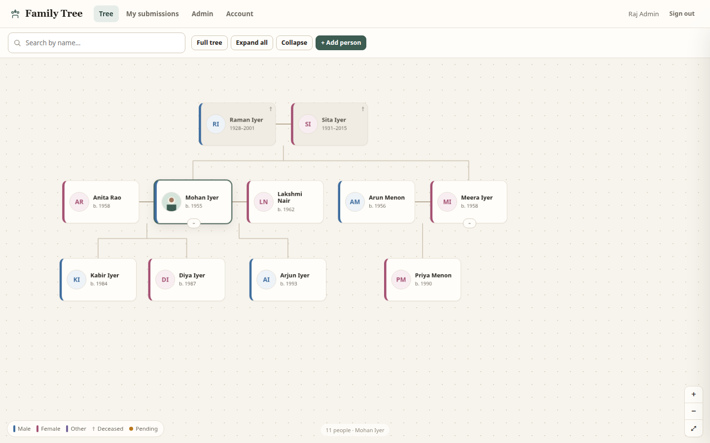

# Family Tree

A lightweight, self-hosted extended-family tree for a homelab. It is designed
for one family, behind an Nginx reverse proxy, on a small always-on server.

- **Single tree**, union-centric data model (parents, spouses, half-siblings,
  remarriages and single known parents are all first-class).
- **Invite links** (single-use, time-bound, optionally pre-linked to an
  unclaimed person) and **self-registration** (invite-only, family passcode, or
  admin approval).
- **Moderated contributions**: regular users can propose changes for themselves
  and their immediate family; nothing goes live until an admin approves it.
- **Admin CRUD** over the whole tree, users, invites, settings, audit history,
  JSON/SQLite export, imports and server-side backups.
- **Interactive canvas** with pan, zoom, search, focus view, collapse/expand and
  a detail drawer. Built for 6–7 generations and usable on a phone.
- **Privacy controls** per person: contact details can be limited to immediate
  family, and any detail group can be marked private.
- **Small footprint**: one Python process, SQLite in WAL mode, no Redis, no
  Node runtime, no CDN dependencies.



---

## Quick start

```bash
cp .env.example .env
python3 -c "import secrets; print(secrets.token_urlsafe(48))"   # paste into SECRET_KEY
# edit BASE_URL and (optionally) TRUSTED_PROXIES

docker compose up -d --build
docker compose logs app | grep -i "setup token"
```

Open `https://family.example.com/setup`, paste the one-time setup token, create
the administrator account and (optionally) the founding patriarch/matriarch.

The container binds to `127.0.0.1:8000`; only the host Nginx should reach it.
For local evaluation, set `BASE_URL=http://localhost:8000` and visit
`http://localhost:8000/setup`.

### Volumes

Compose uses a named volume:

```yaml
volumes:
  - familytree_data:/data
```

To use a bind mount instead, make sure the container's UID can write to it:

```bash
mkdir -p ./data
sudo chown -R 10001:10001 ./data
# then swap the volume line for: - ./data:/data
```

`/data` contains `family.db` (plus WAL files), `avatars/`, `pending/` and
`backups/`. **Keep it on local disk** — SQLite WAL locking is not safe on NFS or
SMB shares.

---

## Cannot sign in, or first-run setup fails

Passwords are stored as Argon2id hashes and cannot be read back. List the
accounts (never shows hashes) and reset one from the host:

```bash
# 1. List accounts: email, role, status, linked person
docker compose exec app python -m app.manage list-users

# 2. Set a new password (prompts securely) and sign out that account everywhere
docker compose exec app python -m app.manage reset-password --email admin@example.com

# 3. Clear a temporary lockout ("Too many sign-in attempts")
docker compose exec app python -m app.manage unlock --email admin@example.com

# 4. Nobody can get in at all? Create a fresh administrator
docker compose exec app python -m app.manage create-admin \
  --email rescue@example.com --name "Recovery Admin"
```

Without arguments the password is prompted twice. Add `--activate` if the
account was disabled or still pending.

### The setup page answers “403 You do not have permission”

This is almost always an address mismatch or a plain-HTTP visit, not a bug:

1. **Address mismatch** — open the app at exactly the address in `BASE_URL`
   (`docker compose exec app python -m app.manage setup-token` prints the
   configured URL and the token). If the page was opened at another host, it
   now says so and offers a confirmation box; the correct fix is to set
   `BASE_URL` to the address you actually use, then
   `docker compose up -d --force-recreate`.
2. **HTTPS mismatch** — if `BASE_URL` is `https://…` but the browser reaches the
   app over plain HTTP, the browser silently drops the security cookies. The
   sign-in page shows a warning in that case, and setup refuses to continue
   rather than leave you with an account you can never sign in with. Fix
   `BASE_URL`, or set `ALLOW_INSECURE_SETUP=true` only if HTTPS is terminated
   where the app cannot see it.
3. **Session expired** — if the page sat open until the session ended, the app
   now says so and simply asks you to submit again.
4. **Proxies that strip `Origin`/`Referer`** are tolerated; a genuine
   cross-site `Origin` is still refused, with the reason shown.

`docker compose exec app python -m app.manage setup-token` fails harmlessly with
a message once an account exists (setup is then complete — use
`reset-password` instead).

---

## Reverse proxy

`nginx.conf` is a complete server block. Replace the domain and certificate
paths, copy it to `/etc/nginx/conf.d/family.conf`, then:

```bash
nginx -t && systemctl reload nginx
```

It demonstrates:

- HTTP → HTTPS redirect, TLS 1.2/1.3 and HSTS.
- `Host`, `X-Real-IP`, `X-Forwarded-For`, `X-Forwarded-Proto`,
  `X-Forwarded-Host` and `X-Forwarded-Port` forwarding.
- `client_max_body_size 8m` for photo uploads.
- Login rate limiting as a second layer in front of the app's own limits.
- Static-asset caching.

Set `TRUSTED_PROXIES=127.0.0.1` when Nginx runs on the host. If Nginx runs in
another Docker container, set it to that network's CIDR (for example
`172.16.0.0/12`) and make sure only the proxy can reach port 8000. The app only
trusts `X-Forwarded-For` when the direct peer is in `TRUSTED_PROXIES`, so client
IPs cannot be spoofed from the internet.

Set `BASE_URL` to the exact public URL. It controls secure-cookie detection,
invite link generation and origin checks. Sub-path hosting (e.g.
`/family/`) is not supported in this version; host it at a domain or subdomain.

---

## Configuration

| Variable | Default | Purpose |
|---|---|---|
| `SECRET_KEY` | generated once | Secret material. Set explicitly in production. |
| `BASE_URL` | `http://localhost:8000` | Public URL; drives cookies and links. |
| `TRUSTED_PROXIES` | `127.0.0.1,::1` | IPs/CIDRs allowed to set `X-Forwarded-For`. |
| `SETUP_TOKEN` | generated | First-run token. Generated into `/data/setup_token` and logged if unset. |
| `DATA_DIR` | `./data` (`/data` in Docker) | SQLite, avatars, backups. |
| `REGISTRATION_MODE` | `invite_only` | Initial mode: `invite_only`, `passcode`, `open`. Admins can change it later. |
| `SITE_TITLE` | `Family Tree` | Initial title; editable in Settings. |
| `MAX_UPLOAD_MB` | `5` | Per-image upload limit. |
| `SESSION_DAYS` | `14` | Session lifetime. |
| `ARGON2_TIME_COST` | `3` | Argon2id cost. Lower only on very small machines. |
| `ARGON2_MEMORY_KIB` | `32768` | Argon2id memory per hash. |
| `ARGON2_PARALLELISM` | `2` | Argon2id threads. |
| `COOKIE_SECURE` | derived from `BASE_URL` | Force secure cookies on/off. |
| `SMTP_HOST`, `SMTP_PORT`, `SMTP_USER`, `SMTP_PASSWORD`, `SMTP_FROM`, `SMTP_STARTTLS` | unset | Placeholder mail relay; not used by the UI yet. |

There is no `.env` loader inside the app when running outside Docker; export the
variables in your shell or use Compose's `env_file`.

---

## Roles and onboarding

### Admin

- Full CRUD over people, unions and links.
- Review queue: approve, reject with a reason, or **edit a submission before
  approving** (including additions; the whole change set is applied atomically).
- Users: approve pending registrations (optionally linking them to a person),
  promote/demote, deactivate, reset passwords, change person links.
- Invites: single-use links, expiry, optional pre-linked person and role.
- Settings: registration mode, family passcode, site title, founding couple.
- Backups, JSON export/import, SQLite snapshots, audit log, per-person history.

### Regular user

- Read the whole tree and all non-private profile data.
- Submit additions/edits for **self and immediate family**.
- Cannot publish directly; changes enter the queue.
- Sees a pending dot on cards with their own open submission and the status of
  their submissions (including rejection reasons).

**Immediate family** is computed from the graph: self, parents (including
step/adoptive links), current and former spouses/partners, full/half/step
siblings, children (including step/adopted), step-parents, step-siblings and
step-children. Cousins, aunts/uncles, grandparents and in-laws are outside the
scope; an admin can make those edits.

## Invite vs. self-registration

- **Invite links** are single-use and expire (1–90 days). The raw token is shown
  once; only a hash is stored. Redeeming creates an active account and can link
  it to an existing person record.
- **Family passcode** mode lets relatives request accounts with a shared
  passcode (Argon2-hashed, rate-limited). Accounts still await admin approval.
- **Open approval** mode allows any registration; all await approval.
- **Invite-only** is the default.

Admins approve accounts from *Admin → Users* and should link them to their
person record. Without a link, the account can browse but cannot submit edits.

---

## Data model

```
persons ──< union_children >── unions ──< union_children >── persons
   │                              │
   └──── parent_child (derived) ──┘
```

- A **union** is a partnership/family unit with up to two partners and any
  number of children. This is what makes half-siblings and remarriage natural:
  the same person can be a partner in several unions, and a child belongs to
  exactly one birth union.
- **`parent_child`** is derived transactionally from unions and child links. It
  makes ancestor queries, cycle checks and scope checks fast in both directions.
- A child can have one **birth** union (partial unique index) plus adoptive,
  step or foster links in other unions.
- Dates are stored as optional day/month/year parts with a certainty qualifier
  (`exact`, `about`, `before`, `after`). Unknown years remain unknown.
- Every mutation bumps `persons.version`, writes an `audit_events` row, and
  updates the search index.
- Pending work lives in `change_sets` and ordered `change_items`; approval
  applies all items in one transaction and re-checks versions.

Cycle and duplication guards run inside write transactions: a person cannot be
their own ancestor, cannot be both partner and child in one union, cannot gain a
second birth family, and a partner cannot be a descendant of a child in that
family.

---

## Moderation workflow

1. A regular user opens a card and chooses **Edit** or **Add relative**
   (father, mother, spouse, son, daughter, brother, sister).
2. The form offers a person search first, to avoid duplicate records.
3. Submission creates a change set with one or more ordered operations:
   new person, new union, partner update, child link, or person update.
4. Nothing is published. The submitter sees a pending badge and can withdraw the
   request from *My submissions*.
5. An admin reviews a side-by-side diff (current vs. proposed, or the proposed
   new member), then approves, rejects with an optional reason, or edits the
   submission and approves it.
6. Approval applies the entire set atomically. If the record changed in the
   meantime, the set is marked *needs attention* instead of overwriting.

---

## Privacy

Per person, in the edit form (self or admin only):

- **Contact visibility**: all family members, immediate family only, or only the
  person and administrators.
- **Private detail groups**: birth details, death details, resting place &
  memorial, contact details, address, notes, profile photo.

Private fields are masked **server-side** — they are never sent to a viewer who
is not allowed to see them. Names and the shape of the tree remain visible to
all signed-in family members. The tree API only receives birth/death years and
avatar URLs that the viewer may see.

Photos are validated by decoding, re-encoded to WebP, stripped of EXIF/GPS
metadata, and served only to authenticated viewers who may see the photo.

---

## Backups, export and import

- **JSON export** (`familytree.v1`) contains every person, union and link,
  including private values. It does **not** contain avatar image files.
- **SQLite snapshot** uses `VACUUM INTO` for a consistent copy and includes
  avatars only if you also copy `/data/avatars` — the `.db` itself contains the
  avatar keys, not the bytes.
- **Server backups** are written to `/data/backups` with a timestamp.
- **JSON import** replaces the tree (people, unions, links) in one transaction,
  validates references and rejects parent/child loops. Accounts are kept, but
  person links and invites are cleared. Type `REPLACE` to confirm. Take a
  snapshot before importing.

Exports contain personal data. Store them encrypted and delete old copies.

---

## Security notes

- Argon2id password hashing; minimum 12-character passwords.
- Opaque 256-bit session tokens stored as SHA-256 hashes; `HttpOnly`, `Secure`
  (when `BASE_URL` is HTTPS), `SameSite=Lax`, revocable, rotated on login.
- Per-session CSRF tokens, `Origin` checks, and CSRF validation on every
  state-changing request.
- Login throttling per IP and per account, exponential account lockout,
  registration/invite/reset limits.
- Jinja autoescaping, strict CSP, no inline scripts, no CDN, no `innerHTML` with
  user data, safe DOM APIs in the tree renderer.
- Upload validation and re-encoding; authenticated media routes; random
  filenames; no user-controlled paths.
- First-run setup requires a token printed to the container log.
- Admin actions and approvals are written to an immutable audit log.
- `X-Forwarded-For` is trusted only from configured proxies.

Not included in v1: two-factor authentication, email delivery, GEDCOM import,
multi-tree tenancy, per-person ACLs beyond the immediate-family rule, and
password reset via email (admins reset passwords manually).

---

## Operating limits

- **One Uvicorn worker by design.** SQLite allows one writer and the in-process
  rate limiter assumes a single process. Do not add `--workers`.
- Comfortable up to a few thousand people. The tree renderer caps displayed
  cards (2,400) and collapses deep branches; use focus, search or per-branch
  expansion for very large trees.
- The tree is laid out from a focus person: their birth family above/alongside,
  then descendants. Click **Focus here** on any card to re-root; **Full tree**
  jumps back to the founding couple.
- A person who appears twice in one branch through a consanguineous marriage is
  drawn once; the duplicate space is kept to avoid obscuring the layout. This is
  a rare cosmetic limitation.
- Schema version 1. Upgrades should be preceded by a SQLite snapshot.

---

## Development

```bash
python3 -m venv .venv
.venv/bin/pip install -r requirements-dev.txt
DATA_DIR=./data SETUP_TOKEN=devtoken BASE_URL=http://127.0.0.1:8000 \
  .venv/bin/uvicorn app.main:app --reload
```

Then open `http://127.0.0.1:8000/setup` and use `devtoken`.

### Tests

```bash
DATA_DIR=/tmp/familytree-test .venv/bin/python -m pytest tests -q
```

The suite covers setup, login/throttling, CSRF and origin checks, invite
single-use/expiry, immediate-family scope, pending approval/rejection, admin
revision, cycle and duplicate-parent guards, privacy masking, photos, role
protection, password reset, and JSON/SQLite round-trips.

### Project layout

```
app/
  main.py            app factory, middleware, error handling
  config.py          environment settings and trusted-proxy IP resolution
  db.py              SQLite connection helpers, WAL, transactions
  schema.sql         schema v1
  security.py        Argon2, tokens, rate limiter
  auth.py            sessions, CSRF guard, route guards
  policy.py          RBAC and field-level privacy masking
  relationships.py   union/child writes, cycles, immediate family
  moderation.py      change sets, diffs, approval/rejection
  media.py           avatar validation and resizing
  routes/            setup, auth, tree, person, moderation, admin
  templates/         Jinja pages and partials
static/              CSS and vanilla JS (tree renderer, forms)
tests/               pytest suite
docs/                screenshots
```

No build step is required: the tree renderer is plain JavaScript, and assets are
served by the app. Nginx can cache `/static/`.

---

## Screenshots

| View | Image |
|---|---|
| Desktop tree | `docs/tree-desktop.png` |
| Person drawer | `docs/drawer-desktop.png` |
| Mobile focus view | `docs/tree-mobile-focus.png` |
| Edit form | `docs/person-form.png` |
| Admin review diff | `docs/admin-review.png` |
| Admin revise before approval | `docs/admin-revise.png` |
